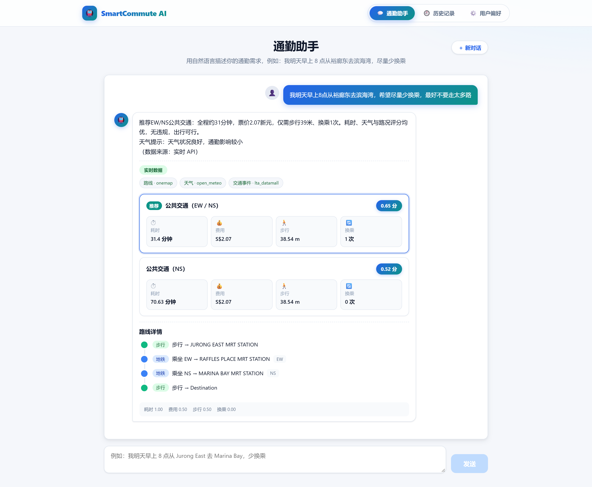
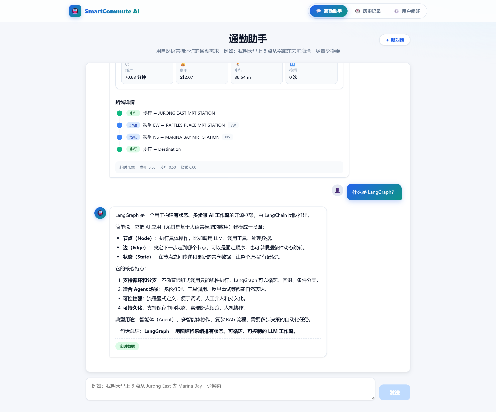

# SmartCommute AI · 智慧通勤 Agent

> 用一句自然语言描述通勤需求，Agent 完成 **需求解析 → 意图分流 → 并行查询 → 确定性评分 → 推荐解释** 的全链路，并在界面上给出可解释的路线对比。




*上图为真实链路截图：路线来自 OneMap，天气来自 Open-Meteo，交通事件来自 LTA DataMall。*

## 这是什么

在新加坡通勤，一次出行决策要同时权衡耗时、票价、步行距离、换乘次数，还要看天气和实时交通事件——这些信息散落在不同平台上，用户得自己拼。

SmartCommute AI 把这件事交给一个 Agent：用户说一句话，系统并行拉取路线、天气、交通事件数据，用确定性算法打分排序，并生成可解释的推荐理由。

**不配置任何 API Key 也能完整跑起来。** 未配置密钥时自动降级为 Mock 数据源，并在界面上逐维度标注来源，绝不把模拟数据冒充成实时数据。

## 界面一览

| 多轮澄清（只说了目的地） | 通勤中追问一般问题（意图分流） |
| --- | --- |
|  |  |

其余界面：[空态与快捷入口](docs/images/01-chat-empty-state.png) · [历史会话](docs/images/05-history.png) · [用户偏好与硬约束](docs/images/06-preferences.png)

## 技术亮点与设计取舍

### 1. 确定性评分，把 LLM 的职责限制在"理解"和"表达"

LLM 只做三件事：解析自然语言需求、分类意图、生成推荐解释。**排序与打分完全由确定性 Python 代码完成**——权重归一化、缺失指标按中性值 0.5 处理、硬约束优先并标记不可行。

这么做是因为排序依据必须**可规定、可调参、可解释**：大模型没有声明权重与优先级的接口，只能改提示词再观察它变成什么样。

为此做了一个[对照实验](docs/experiment-llm-ranking.md)（4 条候选路线 × 4 个偏好场景 × 重复 10 次）：实测 `temperature=0` 下大模型输出**是可复现的**（40 次重复完全一致），所以「大模型排序不可复现」这个常见说法在本场景**并不成立**；真正的问题是它在 4 个场景下的首推结果与加权评分模型**全部不同**，且无法调参纠正。确定性评分则让最难验证的那部分变成了纯函数断言。

评分结果输出为逐项明细（耗时/费用/步行/换乘各自的得分），前端直接展示，用户能看到"为什么推荐这条"。

### 2. 多轮对话里的意图分流

Agent 在多轮会话中必须区分两类输入：

- **上下文补充** —— "换一条少走路的路线"，应当继续规划；
- **话题跳转** —— 通勤途中突然问"什么是 LangGraph"，应当直接回答。

两者的文本特征很像，用关键词规则必然误判。做法是：解析需求之后**始终**执行一次意图分类，并把「当前是否已有通勤上下文」作为特征一起交给模型联合判断，而不是用"有没有上下文"做规则短路。仅当分类器本身异常、且已有通勤上下文时，才兜底走通勤链路，避免多轮补充被丢掉。

上图中第三个场景就是这条路径：同一个会话里先规划路线，再追问 LangGraph，模型正确识别为话题跳转。

### 3. 数据来源语义：只有真实来源 + 调用成功才算"实时"

每个 MCP 工具统一返回 `status / data / source / queried_at / error`。后端汇总为路线、天气、交通事件三个维度各自的来源与状态，再计算整体状态：

| overall | 含义 |
| --- | --- |
| `live` | 全部为真实来源且调用成功 |
| `degraded` | 混合状态（部分真实、部分模拟、部分失败） |
| `mock` | 全部为模拟数据 |
| `error` | 全部失败 |

这里有一条刻意设下的规则：**不凭"请求成功"就认定真实**。真实调用失败时，结果既不冒充实时、也不冒充 Mock，而是归入 `degraded` 或 `error`。前端按维度渲染标签，用户一眼能看出哪个维度是真实数据、哪个是模拟。

## 架构

```
用户 ──> React 前端 ──> FastAPI 后端
                            │
                            ├──> LangGraph 工作流（状态机 + SQLite Checkpointer）
                            │      解析需求 → 意图分流 → 检查缺失字段
                            │      →（澄清 | 并行查询）→ 规范化 → 评分 → 推荐
                            │                    │
                            │              MCP Client（stdio）
                            │                    │
                            │      Mobility MCP Server / Weather MCP Server
                            │                    │
                            │   OneMap · LTA DataMall · Open-Meteo · Mock
                            │
                            ├──> SQLAlchemy（用户/会话/消息/通勤计划/工具日志）
                            └──> LangGraph Checkpointer（按 thread_id 恢复多轮会话）
```

两个 MCP Server 以 stdio 子进程方式由 MCP Client 拉起；数据源以适配器模式封装，Server 启动时按环境变量选择实现。详细说明见 [docs/architecture.md](docs/architecture.md)。

## 技术栈

| 层 | 技术 |
| --- | --- |
| 后端 | Python 3.11+、FastAPI、LangGraph、LangChain、DeepSeek（OpenAI 兼容）、Pydantic、SQLAlchemy |
| MCP | 官方 `mcp` Python SDK（FastMCP），两个独立 Server |
| 数据源 | OneMap（路线）、LTA DataMall（交通事件）、Open-Meteo（天气，免费无需 Key）、DeepSeek（LLM） |
| 前端 | React 18、TypeScript、Vite、react-markdown |
| 数据库 | SQLite（默认）/ PostgreSQL（预留） |
| 测试 | pytest（108 个） |
| 部署 | Docker、Docker Compose |

## 快速开始

前置要求：Python 3.11+、Node.js 18+（推荐 20+）、npm。

### 一键启动

```bash
# Windows
scripts\dev.bat

# macOS / Linux / Git Bash
bash scripts/dev.sh
```

脚本会自动创建虚拟环境、启动后端、等待就绪，再启动前端。

### 手动启动

```bash
# 1. 配置环境变量（缺省即为 Mock 模式，可直接跳过）
cp .env.example .env

# 2. 后端
python -m venv .venv
.venv\Scripts\activate          # macOS/Linux: source .venv/bin/activate
pip install -r backend/requirements.txt
uvicorn app.main:app --app-dir backend --host 0.0.0.0 --port 8000

# 3. 前端
cd frontend
npm install
npm run dev
```

打开 <http://localhost:5173> 即可使用，接口文档在 <http://localhost:8000/docs>。

> 调试时建议不要加 `--reload`：热重载与请求存在竞态，可能用旧代码处理请求。改完代码手动重启更可靠。

### 试一句

> 我明天早上 8 点从裕廊东去滨海湾，希望尽量少换乘，最好不要走太多路

<details>
<summary>配置真实数据源（可选，不配置则走 Mock）</summary>

| 变量 | 作用 | 申请地址 |
| --- | --- | --- |
| `DEEPSEEK_API_KEY` | 需求解析、意图分类、推荐解释、通用问答 | <https://platform.deepseek.com> |
| `ONEMAP_TOKEN` | 首选路线源（新加坡官方，免费） | <https://www.onemap.gov.sg> → API / Developer |
| `LTA_ACCOUNT_KEY` | 交通事件（免费） | <https://datamall.lta.gov.sg> |
| `GOOGLE_MAPS_API_KEY` | 次选路线源（付费，需绑卡） | <https://console.cloud.google.com> |

天气默认使用 Open-Meteo，免费且无需 Key。

验证真实调用：

```bash
python scripts/verify_open_meteo.py      # 天气
python scripts/verify_google_maps.py     # Google 路线（需 Key）
```

所有密钥只保存在后端 `.env`，不写入源码、前端或 Git。

</details>

## 测试

```bash
pytest -q     # 108 passed
```

测试在 `tests/conftest.py` 中切换到独立数据库（`test_smartcommute.db`）并强制 Mock 数据源，既不会污染演示数据，也不依赖外网。覆盖范围包括路线评分确定性（权重归一化、缺失值、硬约束）、工作流编排、多轮会话恢复与 thread 隔离、LLM 降级、意图分流、各数据源适配器、来源汇总与 HTTP 接口。

## 项目结构

```
SmartCommute-Agent/
├── backend/app/
│   ├── agent/          # LangGraph 工作流（graph / state / checkpointer）
│   ├── api/            # 路由：chat / sessions / commutes / preferences
│   ├── services/       # MCP Client、LLM Service、路线评分
│   ├── models/         # SQLAlchemy 实体
│   └── repositories/   # 数据访问层
├── mcp_servers/
│   ├── mobility_server.py
│   ├── weather_server.py
│   └── shared/         # OneMap / LTA / Open-Meteo 适配器与 Mock 实现
├── frontend/src/       # React + TypeScript
├── scripts/            # 一键启动与真实 API 验证脚本
├── tests/              # pytest
└── docs/               # 架构说明、技术评估、README 截图
```

## 文档

- **[design-decisions.md](docs/design-decisions.md)** —— 关键技术决策记录：每条决策都写了当时的其他选项和付出的代价
- **[experiment-llm-ranking.md](docs/experiment-llm-ranking.md)** —— 对照实验：路线排序该由大模型还是确定性代码承担（含推翻原假设的过程）
- **[lessons.md](docs/lessons.md)** —— 问题记录与复盘：按「现象 → 定位 → 根因 → 修复 → 沉淀」组织，保留判断失误的过程
- [architecture.md](docs/architecture.md) —— 系统当前如何工作：数据流、意图分流、MCP 设计、评分策略、错误与降级
- [opentripplanner-evaluation.md](docs/opentripplanner-evaluation.md) —— OpenTripPlanner 引入可行性评估（结论：暂不引入）

## 设计取舍与后续规划

**关于"不做什么"**：评估过用 OpenTripPlanner 替换路线引擎，最终决定不引入——它能解决的只有"路线规划"一个维度，交通事件和天气仍需额外数据源，却要额外背上 Java 运行时、几 GB 的图构建和 GTFS 数据更新管道。评估过程完整记录在上述文档中。

几处明确的现状与取舍：

1. **地图展示**：当前用路线卡片 + 步骤时间线替代地图 UI。地图不是核心链路，先保证推荐结果本身可解释。
2. **流式响应**：当前是稳定的请求-响应，未做 SSE。推荐结果需要等待并行查询与评分全部完成，流式的收益有限。
3. **数据库**：默认 SQLite，已预留 PostgreSQL 连接串，但尚未验证生产部署与 Alembic 迁移。
4. **CI**：尚未接入 GitHub Actions，测试目前依赖本地手动执行。

后续计划：接入 CI（pytest + tsc 自动跑）→ 补 Alembic 迁移 → 评估 PostgreSQL 部署 → 再考虑地图 UI 与 SSE。
